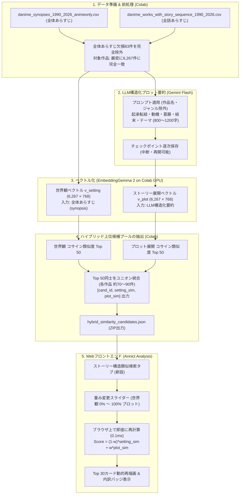

# アニメストーリー構造類似度検索 確定再設計仕様書（アプローチ1）

## 1. 概要と目標
dアニメストアに配信されているアニメ作品（6,350件中、有効なあらすじを持つ**6,267件**）を対象に、**「アプローチ1: LLM構造化ストーリー要約 ＋ デュアルベクトルハイブリッド（世界観 × ストーリー展開）」** を採用した次世代の類似度検索システムを構築・運用する。

---

## 2. 確定仕様と設計方針

| 項目 | 決定仕様 | 詳細説明 |
| :--- | :--- | :--- |
| **採用手法** | **アプローチ1（LLM構造化要約 ＋ EmbeddingGemma 2）** | 全話あらすじからLLM（Gemini Flash）を用いて起承転結・動機・葛藤・結末・テーマを800〜1,200字に構造化要約し、それをベクトル化。日常回や固有名詞ノイズを排除し、均一な高密度プロット情報を抽出。 |
| **デュアルベクトル構成** | **世界観ベクトル $\times$ ストーリー展開ベクトル** | - **世界観ベクトル $v_{setting}$** (768次元): 作品全体のあらすじ（synopsis）からエンコード<br>- **ストーリー展開ベクトル $v_{plot}$** (768次元): 全話あらすじのLLM構造化要約からエンコード |
| **重み変更機能** | **Webアプリケーション上で無段階変更可能** | ブラウザ上のスライダーで世界観比率（$1-w$）とストーリー展開比率（$w$）を自由に変更可能。上位候補プール方式により、**0ミリ秒（待ち時間ゼロ）でリアルタイムにTop30が再ソート**される。 |
| **同一シリーズの扱い** | **除外せず含める** | 同一シリーズ除外フィルタは適用せず、類似度スコア順にそのまま含めて表示する。 |
| **メタデータの扱い** | **タイトル・ジャンルは利用しない** | ベクトル化の入力テキストには作品タイトルやジャンルを一切含めず、純粋なあらすじ文章・プロット構造のみからセマンティック類似度を算出する。 |
| **作品除外ルール** | **全体あらすじ欠損作品（83件）を除外** | 全体あらすじ（synopsis）が存在しない83件を全各話エピソードプログラム側でも同様に除外。両データセットの対象母集団を**厳密に6,267件で完全統一**する。 |
| **計算環境** | **Google Colab（GPU）** | 要約生成（Gemini API）およびベクトル化・類似度候補抽出（EmbeddingGemma 2）はGoogle Colab上で一括自動実行する。 |

---

## 3. システムアーキテクチャ



---

## 4. プロット構造化要約プロンプト設計

各話エピソードあらすじからノイズ（日常回、固有名詞の羅列等）を排し、純粋な物語構造の骨格を抽出するプロンプト：

```text
あなたはアニメの物語構造分析の専門家です。
以下のアニメの「全話各話あらすじ」を分析し、作品全体のストーリー展開の骨格を以下のフォーマット（800〜1200文字程度）で構造化して出力してください。
※作品名やキャラクター固有の固有名詞に過度に依存せず、「どのような動機で」「どのような葛藤や事件があり」「どう転換し」「どう解決・結末を迎えるか」のプロット構造を明確に記述してください。

【基本設定・動機】主人公の境遇、物語を動かす根源的な動機・目的
【発端・展開】日常の崩壊、冒険や戦いの開始、仲間との出会い・対立
【転換点・危機】物語最大の試練、裏切り、隠された真実の発覚、絶望
【結末・解決】最終局面の展開、対立の決着、主人公や世界の帰結
【テーマ・トーン】作品全体を貫く主題（例: 運命への抗い、復讐の虚しさ、少年の精神的成熟）
```

---

## 5. 上位候補プール方式（Candidate Pooling）の技術仕様

### なぜ候補プール方式なのか？
1. **全ペア保持の課題**: $6,267 \times 6,267$ の行列（約300MB以上）をブラウザに持たせると、ロード時間が長大化しメモリを圧迫する。
2. **サーバーAPI問い合わせの課題**: スライダー操作ごとにAPIを叩くと通信遅延（100〜300ms）が生じ、ドラッグ時の操作感が損なわれる。
3. **解決策**:
   - 各作品について「世界観Top 50」と「プロットTop 50」をマージした**約70〜90件の候補リスト**だけをJSONに保持。
   - JSONサイズは **約12〜14MB（gzip圧縮時 約3〜4MB）** と既存と同等。
   - ブラウザのJavaScriptで約80件の数値を掛け算してソートするだけなので、計算時間は **0.1ミリ秒未満**。スライダーをドラッグしながらリアルタイムにカードが入れ替わる。
   - Top50の両方から外れた作品がTop30に食い込むことは数学的にあり得ないため、**取りこぼしは実用上ゼロ**。

---

## 6. Webアプリケーション UI仕様

1. **タブ配置**:
   - `index.html` に「類似アニメ検索」「エピソード類似検索」に続く第3のタブ**「ストーリー構造類似検索」**を追加。
2. **画面コンポーネント**:
   - 既存の「類似アニメ検索」「エピソード類似検索」と**100%同一のルック＆フィール**。
   - 検索バー（インクリメンタルサーチ、全角半角正規化）。
   - クイック選択タグ（代表作チップ）。
   - 選択中作品のヒーローカード（Annict高画質キービジュアル、基本情報、あらすじ、構造化要約タブ切替）。
   - **【新設】デュアル・アスペクト重みコントローラー**:
     - スライダー: 「世界観重視 (0%) ⟷ バランス (50%) ⟷ プロット重視 (100%)」
     - プリセットボタン（「プロット重視(8:2)」「バランス(5:5)」「世界観重視(2:8)」）
   - 類似作品Top 30カードグリッド:
     - 総合類似度スコア
     - スコア内訳バッジ（`プロット: XX%` / `世界観: YY%`）
     - 数珠つなぎ探索ボタン
